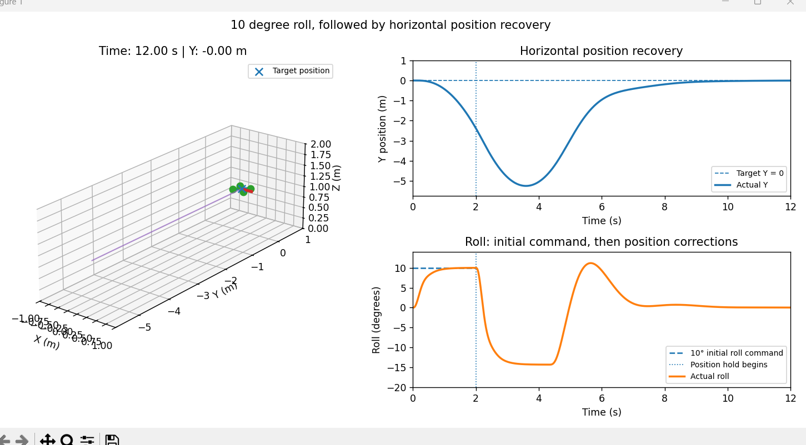

# 6 degree-of-freedom Quadrotor Flight Control Simulator

A Python simulation of a 1 kg quadrotor with six degrees of freedom. The project models how a drone responds to forces and motor commands, while using feedback control to stabilize its flight and return to its starting position. The results are demonstrated in a 3D animation.



## About the project:

The simulator models the quadrotor as a rigid body moving in 3D space. It calculates the effects of motor thrust and torque on motion while also accounting for aerodynamic drag (quadratic). I represented orientation with quaternions and used a fourth-order Runge-Kutta (RK4) method to numerically integrate the equations of motion over time. 

The four rotors are positioned in an X-shape about the center of the quadrotor. Their speeds determine the thrust and torque acting on the drone. The simulator accounts for lag in motor response since the motor speeds are not presumed to change speed instantly upon command. I additionally implemented proportional derivative (PD) controllers to control the drone's altitude (height) and attitude (orientation). The controller.py file also calculates the roll and pitch corrections necessary to reduce translational position and velocity error. The simulation uses a time step of 0.01 s.

## Demo

`visualization.py` runs a 12-second simulation in two parts:

Part 1: **0–2 s:** Commands a 10° rolling motion which causes the drone to accelerate sideways
Part 2: **2–12 s:** Switches to position control targeting `(0, 0, 1)` meters. The drone counter-tilts to brake, returns toward its starting point, and settles as close to the target as possible.

In the example run, the roll reaches approximately **9.993°** at two seconds. The drone initially moves sideways, then returns to within approximately **0.005 m** of its original Y-position by 12 seconds, with altitude near the target of **1 m**. 

## Prerequisites

Requires Python 3 and the following packages:

```bash
python -m pip install numpy matplotlib
```

Run the animated demonstration:

```bash
python visualization.py
```

Run the two earlier experiments:

```bash
python simulate.py          
python test_controller.py  
```

## Project files

| File | Role |
| --- | --- |
| `dynamics.py` | Kinematics, RK4 integration |
| `actuators.py` | Rotor thrust/torque calculations, motor response |
| `controller.py` | attitude/altitude control, horizontal position control |
| `simulate.py` | Open-loop flight experiment |
| `test_controller.py` | Closed-loop attitude-control experiment |
| `visualization.py` | 3D demo of position recovery |

## Limitations to the model:

The simulator uses approximate parameters for a 1 kg quadrotor rather than measurements from an actual drone. Its drag model and response model are simplified. It does not account for complex propeller aerodynamics or interactions with the ground. The controller additionally does not estimate the drone's simulated position and velocity from sensor measurements. Although the controller returns the drone to its target in the scenarios shown, its performance has not ben tested in every flight condition.

**Status:** Initial version developed in September 2026.
